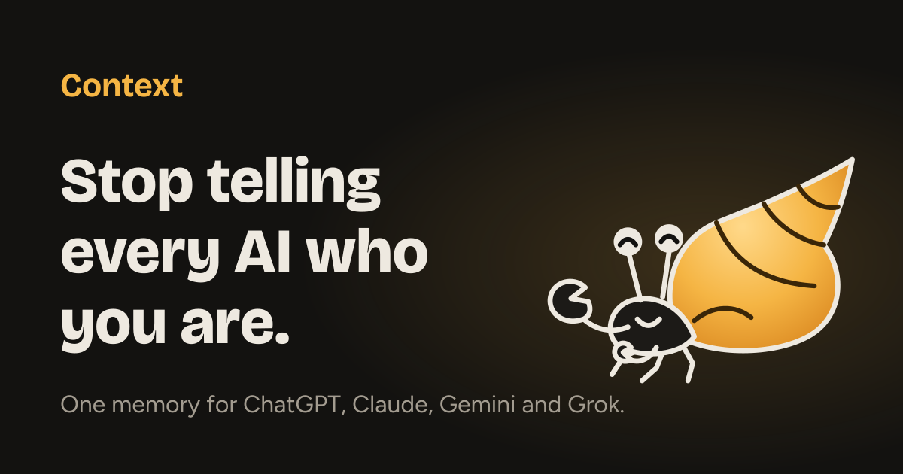

<p align="center">
  <a href="https://keepyourcontext.com">
    
  </a>
</p>

<h1 align="center">Context</h1>

<p align="center">One memory you own, shared by ChatGPT, Claude, Gemini and Grok.</p>

<p align="center">
  <a href="https://keepyourcontext.com"><strong>Use Context</strong></a> ·
  <a href="https://keepyourcontext.com/docs">Docs</a> ·
  <a href="https://keepyourcontext.com/privacy">Privacy</a> ·
  <a href="SECURITY.md">Security</a> ·
  <a href="https://keepyourcontext.com/version">Running commit</a>
</p>

<p align="center">
  <a href="https://keepyourcontext.com">
    
  </a>
</p>

Context is a long-term memory that all your AI assistants share. Tell Claude about a project, a preference or a decision, and ChatGPT, Gemini and Grok can use it too. Every memory is yours to see, edit, export and delete.

It's a remote [MCP](https://modelcontextprotocol.io) server on Cloudflare Workers. This repository is the code that runs **[keepyourcontext.com](https://keepyourcontext.com)**, published so you can check what happens to your memories instead of taking our word for it.

**The easiest way to use Context is the hosted version: it's free for personal use, and there's nothing to install.** If you'd rather run your own copy, see [Running your own copy](#running-your-own-copy).

## What you get

- **One memory for every AI app.** Connect ChatGPT, Claude, Gemini and Grok once; what one learns, the others can use.
- **You can see everything.** Each memory shows which app saved it, when, and whether you said it or the AI guessed it.
- **You have the last word.** Search, edit, confirm or forget any memory on the website, or ask your AI to.
- **Bring it in.** Move what ChatGPT or Claude already knows about you in about 30 seconds.
- **Take it with you.** Download everything as Markdown or JSON at any time, or delete your account and every connected app loses access.

[Pro](https://keepyourcontext.com/#pricing) adds history you can undo, search by meaning, a weekly cleanup of duplicates, Google Drive backups and personal API keys.

## Get started

1. Sign in at [keepyourcontext.com](https://keepyourcontext.com) with Google.
2. Open the [Connect page](https://keepyourcontext.com/connect) and add Context to each AI app you use. It shows the steps for each app and the address to paste: `https://keepyourcontext.com/mcp`.
3. Approve each app when it sends you to the "Allow … to use your Context?" page.

## What this code does with your data

This describes keepyourcontext.com, which is run by DialVia Limited ("we").

- **AI apps only see what they save or ask for.** The six tools in [`src/mcp.ts`](src/mcp.ts) take short facts the assistant chose to save (one sentence each) and return the memories you've saved. Your conversations, chat history and the assistant's own memory never reach Context: no tool accepts them.
- **What's stored:** your Google account id and email, and your memories (text, category, which app saved it, whether you said it or the AI inferred it, dates). On Pro, also: hashes of your API keys, embeddings of your memories (in Vectorize), cleanup suggestions, and, if you connect Google Drive, that account's email and an AES-GCM-encrypted refresh token. The tables are in [`migrations/`](migrations). Assistants are told not to save health details, passwords or secrets ([`src/mcp.ts`](src/mcp.ts)).
- **Where:** a Cloudflare D1 database in Western Europe, encrypted at rest by Cloudflare. There's no extra encryption in the app, so whoever runs the service can technically read the database. We don't look at anyone's memories except to fix a problem you've reported. OAuth tokens are stored only as hashes, by [`@cloudflare/workers-oauth-provider`](https://github.com/cloudflare/workers-oauth-provider).
- **Nothing is sent anywhere else.** The code makes outbound calls only to Google (to sign you in, [`src/web.ts`](src/web.ts), and on Pro to write backups to your own Drive, [`src/backup.ts`](src/backup.ts)) and Stripe (Pro billing, [`src/stripe.ts`](src/stripe.ts)). The only AI calls are Pro features on Cloudflare's own Workers AI: embeddings for search by meaning ([`src/semantic.ts`](src/semantic.ts)) and the weekly cleanup model ([`src/cleanup.ts`](src/cleanup.ts)). There are no third-party analytics, ads or third-party LLM calls (the private `/stats` page counts signups and connected apps, never memory content), and memories are never used for training.
- **Each app needs your consent** on the "Allow … to use your Context?" page before it can connect ([`src/web.ts`](src/web.ts), `/authorize`).
- **You control it:** edit or forget any memory on the website, download everything as JSON or Markdown ([`src/export.ts`](src/export.ts)), or delete your account, which revokes every connected app and the Drive connection and deletes your rows (`deleteUserData` in [`src/memories.ts`](src/memories.ts)); the daily cron then deletes their embeddings from Vectorize (`pruneVectors`). On Free, edits and forgets are permanent; Pro keeps history you can restore, deleted 30 days after Pro ends.
- **What's running is this code.** Every push to `main` is typechecked, migrated and deployed by [`.github/workflows/deploy.yml`](.github/workflows/deploy.yml), and [/version](https://keepyourcontext.com/version) shows the commit that's live.

Found a security problem? Please report it privately, as [SECURITY.md](SECURITY.md) describes.

## How it works

```
ChatGPT / Claude ──(MCP + OAuth token)──► /mcp ──► src/mcp.ts (6 tools) ──► D1 (SQLite)
        │                                                                     ▲
        └─ first connect: /authorize ─► Google sign-in ─► consent page        │
You (browser) ──► / , /import, /connect ──► src/web.ts ─────────────────────────┤
Scripts (Pro API key) ──► /api/v1 ──► src/api.ts ───────────────────────────────┘
```

| File | What it does |
|---|---|
| `src/index.ts` | Entry point. `OAuthProvider` guards `/mcp` and serves the OAuth endpoints; everything else goes to the web app. |
| `src/mcp.ts` | The MCP server (6 tools): `search_context`, `get_context`, `remember`, `update_memory`, `merge_memories`, `forget_memory`, plus the instructions that tell assistants when to use them. Claude gets descriptive wording that fits Anthropic's directory policy; other apps get the wording the bench measured. |
| `src/web.ts` | Google sign-in, the "Allow Claude to use your Context?" consent page, memory list, import, connect instructions, and the public pages (`/what-ai-knows`, guides, blog, `/sitemap.xml`, `/robots.txt`). |
| `src/memories.ts` | All database access and the (deliberately simple) keyword search. |
| `src/semantic.ts` | Pro: search by meaning. Workers AI embeddings (`bge-m3`) in Vectorize, blended with keyword search; falls back to keywords if either is missing or fails. |
| `src/cleanup.ts` | Pro: weekly cleanup. A Workers AI model suggests merges and forgets, which the user applies on `/cleanup` (or merges are applied automatically if they opt in). |
| `src/backup.ts` | Pro: Google Drive backups (`drive.file` scope), daily or weekly, newest 30 kept. |
| `src/apikeys.ts`, `src/api.ts` | Pro: personal API keys, accepted on `/mcp` (via `resolveExternalToken` in `index.ts`) and by the REST API at `/api/v1`. |
| `src/ratelimit.ts` | Per-account request limit (120 a minute) on `/mcp` and `/api/v1`. |
| `src/importer.ts` | The prompt you paste into ChatGPT (plus the public variant on `/what-ai-knows`), and a parser for its answer. No LLM calls on our side. |
| `src/content/` | Guides (`/guides/<slug>`) and blog posts (`/blog/<slug>`). `types.ts` defines an `Article`; each article is a module in `articles/` that must be imported into the list in `index.ts`. Also listed in `/sitemap.xml`. |
| `src/export.ts` | JSON and Markdown downloads of all active memories. The Markdown uses the import line format, so it can be re-imported. |
| `src/referrals.ts` | Invites: `/r/<code>` links, and a month of Pro for both people when the friend approves their first AI app. |
| `src/funnel.ts` | Funnel tracking for the private `/stats` page: where each user came from, which AI apps they connected and used, and the numbers per source. |
| `src/og.ts` | The link-preview card (og:image); `scripts/render-og.sh` renders it to `public/og.png`. |
| `src/review-login.ts` | TEMPORARY: email and password sign-in at `/review-login` for app-directory reviewers, who can't use Google accounts with 2-step verification. Off unless the `REVIEW_LOGINS` secret is set; removed once the directory reviews are done. |
| `scripts/grant-pro.mjs` | `npm run grant-pro`: give an account Pro by hand, e.g. yourself on your own copy. |
| `src/crab.ts` | The hermit crab mascot as inline SVG, in six moods. |
| `public/` | `site.css` and self-hosted fonts, served as static assets before the Worker runs. |
| `src/stripe.ts` | Pro billing: Stripe Checkout with Managed Payments, the customer portal, and the webhook that sets each account's plan. |
| `src/session.ts` | Signed login cookie (no session table). |
| `migrations/` | D1 schema. |

Cost-relevant choices: stateless MCP handler (no Durable Objects), keyword search in the Worker for Free (Vectorize only for Pro, embedded lazily on search), import parsed without an LLM, per-account write limits, and hourly crons that each process a few Pro accounts. The free features fit the Cloudflare free plan; the Pro features use Workers AI and Vectorize, which have free allowances but are better on Workers Paid as Pro grows.

## Running your own copy

You're welcome to run Context for yourself: the [license](LICENSE.md) allows that, as long as you don't offer it to other people as a hosted service. It runs on Cloudflare's free plan.

### 1. Google sign-in (about 5 minutes)

Google only confirms who you are; your memories never go to Google.

1. Go to <https://console.cloud.google.com>, create a project (e.g. "Context").
2. Open **Google Auth Platform** → **Get started**. App name "Context", your email as support and contact email, audience **External**.
3. Under **Audience**, leave the app in **Testing** and add your Google address as a **test user**. Testing mode is fine for personal use: no Google review is needed for the `openid email` scopes. (If you turn on Drive backups, publish the app to **In production**: in Testing, Google expires refresh tokens after 7 days and backups stop.)
4. Under **Clients** → **Create client** → type **Web application**. Add this authorized redirect URI:
   - `http://localhost:8787/auth/google/callback`
   - `https://YOUR_DOMAIN/auth/google/callback` (once you deploy)
5. Copy the **Client ID** and **Client secret**.

### 2. Run it locally

1. `npm ci`, then copy `.dev.vars.example` to `.dev.vars` and fill in `GOOGLE_CLIENT_ID`, `GOOGLE_CLIENT_SECRET` and `SESSION_SECRET` (`openssl rand -base64 48`). Sign-up is open (`OPEN_SIGNUP` in `wrangler.jsonc`); set it to `"false"` in `.dev.vars` to limit sign-in to `ALLOWED_EMAILS`.
2. `npm run db:migrate:local`
3. `npm run dev`, then open <http://localhost:8787>.

ChatGPT and Claude can't reach `localhost`, so connecting them requires deploying.

### 3. Deploy to your Cloudflare account

1. Create the database and key-value store, and put their ids in `wrangler.jsonc` (`database_id`, and the `OAUTH_KV` id):
   ```sh
   npx wrangler d1 create context-db
   npx wrangler kv namespace create OAUTH_KV
   ```
2. In `wrangler.jsonc`, set `PUBLIC_URL`, `COMPANY_NAME`, `SUPPORT_EMAIL` and `ADMIN_EMAILS` to your own, change `routes` to your domain (or remove it and set `"workers_dev": true`), and remove `SOURCE_URL`, `MCP_REGISTRY_AUTH` and the `STRIPE_PRICE_*` ids. Without Stripe, billing stays switched off.
3. Set the secrets: `npx wrangler secret put` for `GOOGLE_CLIENT_ID`, `GOOGLE_CLIENT_SECRET` and `SESSION_SECRET`.
4. `npm run db:migrate:remote`, then `npm run deploy`.

ChatGPT, Claude and the others can then connect to `https://YOUR_DOMAIN/mcp`.

### Optional: the Pro features

Each one switches itself off when its binding or secret is missing, so you only set up what you want. They work for accounts on the Pro plan; give yourself Pro with `npm run grant-pro -- you@example.com` (add `--local` for the local database).

- **Search by meaning** (bindings `AI` and `VECTORS`): create the index once, with the metadata index before any vectors go in:
  ```sh
  npx wrangler vectorize create context-memories --dimensions=1024 --metric=cosine
  npx wrangler vectorize create-metadata-index context-memories --property-name=user_id --type=string
  ```
  `MIN_SIMILARITY` in `src/semantic.ts` (0.5) is the cut-off for a meaning-only match.
- **Automatic cleanup** needs only the `AI` binding.
- **Google Drive backups:** enable the Google Drive API in your Google Cloud project, add the `https://www.googleapis.com/auth/drive.file` scope under Data access, add `https://YOUR_DOMAIN/backup/google/callback` to your OAuth client, and set a key: `openssl rand -base64 48 | npx wrangler secret put TOKEN_ENCRYPTION_KEY`. Publish the Google app to In production, or Google expires the connection after 7 days.
- **API keys** need nothing extra. `/mcp` and `/api/v1` share a limit of 120 requests a minute per account through the `RATE_LIMIT` binding ([`src/ratelimit.ts`](src/ratelimit.ts)).

## Development

`npm run typecheck` checks the code. Local setup is step 2 of [Running your own copy](#running-your-own-copy).

### Test bench

`bench/` measures whether Claude uses Context when it should (and leaves it alone when it shouldn't), so changes to tool descriptions or setup advice can be compared instead of guessed.
It runs the real MCP server from `src/mcp.ts` in-process against a throwaway database seeded with a fictional (Pro) user, and talks to Claude through the Anthropic API. Nothing touches production.

- **Scenarios** (`bench/scenarios.ts`): questions that need Context, conflicts with Claude's out-of-date built-in memory, questions that don't need it, facts that should be saved unprompted, changes that should update an existing memory rather than add a duplicate, small talk and one-off tasks that shouldn't be saved, and instructions that should be filed in the right category.
- **Variants** (`bench/variants.ts`): old vs current tool descriptions, "Always available" vs "Auto" tool loading, with or without server instructions and the custom instructions from the connect page.
- **Snapshots** (`bench/snapshots/`): frozen tool definitions to compare against. `v1` is the original release; `v2` is from before `remember`/`update_memory` said not to save an updated fact twice (variants `v2-eager`, `v2-auto+prefs`).

```sh
npm run bench -- --dry                                   # what would run
npm run bench -- --model claude-haiku-5-5 --repeats 1    # cheap smoke run
npm run bench                                            # full matrix
npm run bench -- --variants auto,auto+prefs --scenarios dinner,regex --repeats 5
npm run bench -- --snapshot v2                           # freeze current tool definitions to compare against later
```

Needs `ANTHROPIC_API_KEY` in `.dev.vars` (API usage is billed separately from a Claude subscription). Reports and full transcripts go to `bench/results/` (gitignored).

## Contributing

Bug reports and ideas are welcome as [issues](https://github.com/utkublg/context/issues). Pull requests are closed for now. For security problems, don't open an issue: see [SECURITY.md](SECURITY.md).

## License

Context is released under the [O'Saasy License](LICENSE.md): MIT-style, so you can read, change, self-host and share it, except that you can't offer it to others as a competing hosted service. "Context" and the hermit crab are our branding; if you share a modified copy, please give it your own name.
